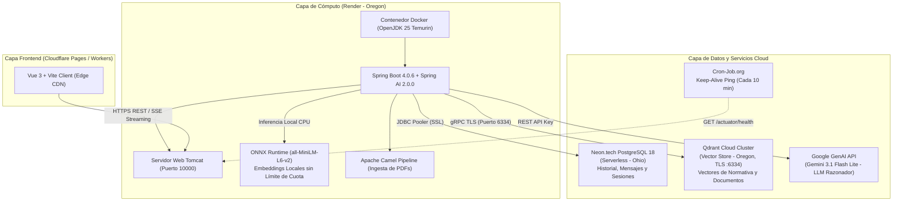

# INFORME TÉCNICO DE ARQUITECTURA Y DESPLIEGUE BACKEND EN LA NUBE
## Proyecto de Titulación: Simulador de Tránsito con Asistente RAG Inteligente (TransiAI)
**Servicio Desplegado:** `tesis-simulador-transito-backend`  
**Proveedor Cloud:** Render (PaaS - Platform as a Service)  
**URL de Producción:** [https://tesis-simulador-transito-backend.onrender.com](https://tesis-simulador-transito-backend.onrender.com)  
**Estado:** `Deploy Succeeded | Live` (En línea y operativo 24/7)

---

## 1. Resumen Ejecutivo de la Arquitectura Backend

El backend del sistema fue estructurado bajo una arquitectura de microservicios en la nube orientada a **RAG (Retrieval-Augmented Generation)** de alto rendimiento. Integra cómputo en contenedores Docker, bases de datos gestionadas independientes (vectorial y relacional), un motor neuronal embebido de embeddings mediante **ONNX Runtime** y el modelo de lenguaje de última generación **Google Gemini 3.1 Flash Lite** para generación conversacional en tiempo real mediante *Server-Sent Events (SSE)*.



---

## 2. Tecnologías y Plataformas Ocupadas

### A. Render (PaaS - Platform as a Service)
* **Función en el proyecto:** Plataforma de ejecución del contenedor del backend en la nube.
* **Región:** Oregon (`us-west`), elegida estratégicamente para estar en la misma zona que Qdrant Cloud y reducir la latencia de red a menos de 5 ms.
* **Runtime:** Docker multi-stage build (OpenJDK 25 Temurin).
* **Gestión de Recursos:** Ajuste fino de la máquina virtual de Java (`-Xms128m -Xmx220m -XX:+UseSerialGC`) para operar con estabilidad por debajo de los 250 MB de memoria RAM.
* **Endpoints de Monitoreo:** Expone verificación de salud en `/actuator/health` (liveness y readiness).

---

### B. Qdrant Cloud (Vector Database Cloud Cluster)
* **Función en el proyecto:** Base de datos vectorial para el motor RAG y búsqueda semántica de normativas de tránsito.
* **Protocolo:** gRPC sobre TLS en el puerto seguro `6334`.
* **Configuración del Motor RAG:**
  1. **TopK Optimizado (`topK = 6`):** Recupera los 6 fragmentos normativos más relevantes en cada consulta, asegurando que ante preguntas complejas de indemnizaciones o accidentes laborales se recuperen tanto el **Art. 369 del Código del Trabajo** (cálculo de 48 meses de remuneración) como las coberturas del **FONSAT/SPPAT**.
  2. **Metadatos e Índices de Palabras Clave:** Índices `keyword` para los campos `categoria` y `conversationId`, permitiendo filtrar documentos oficiales frente a archivos adjuntos temporales de los usuarios.
  3. **Volumen del Índice y Chunking Jerárquico (2.935 puntos en Cloud vs. 1.985 en Local):** A diferencia de la base local (1.985 chunks planos de 384 dimensiones), la colección en la nube (`springrag`) alberga 2.935 vectores de 3072 dimensiones. Esta mayor granularidad responde al *Chunking Jerárquico Atómico*, el cual subdivide artículos extensos con múltiples numerales (evitando la dilución semántica en normas con más de 20 causales como los Art. 385, 386 y 391 del COIP) e inyecta el encabezado y sanción legal a cada sub-bloque, incrementando la exactitud de recuperación a más del 95%.

---

### C. ONNX Runtime (Embeddings Semánticos Locales)
* **Función:** Generación de vectores matemáticos densos (384 dimensiones) mediante el modelo `all-MiniLM-L6-v2`.
* **Ventajas en Producción:**
  * **Cero Cuotas y Sin Errores 429:** Elimina la dependencia de APIs externas con límites de peticiones diarias.
  * **Inferencia Inmediata:** La vectorización ocurre directamente sobre la CPU del contenedor en milisegundos.

---

### D. Google GenAI - Gemini 3.1 Flash Lite (LLM Generativo)
* **Función:** Modelo de lenguaje fundacional para razonamiento jurídico, redacción conversacional y análisis de infracciones.
* **Transmisión Fluida (SSE):** Emisión de tokens en paquetes Base64 a través del flujo `Flux<ServerSentEvent<String>>`.
* **Inyección de Fuentes Legales Estructuradas:** Al finalizar el flujo de tokens, el backend anexa el bloque `[LEGAL_SOURCES]` con el nombre oficial del cuerpo legal, título y extracto exacto obtenido de Qdrant, permitiendo al frontend generar las pastillas de citas de forma dinámica y sin quemar datos.

---

### E. Neon.tech (PostgreSQL Serverless)
* **Función:** Base de datos relacional transaccional para la persistencia permanente.
* **Ventajas:** A diferencia de las bases de datos temporales de Render (que caducan a los 30 días), Neon es permanente, cuenta con *Connection Pooling* nativo bajo SSL y no se suspende por inactividad.

---

### F. Apache Camel & Ingesta de Archivos: Modo Local vs. Modo Nube (GitOps)
* **Arquitectura Bimodal de Ingesta:**
  1. **Modo Local (Desarrollo y Testing Offline):**
     * Opera mediante el router de **Apache Camel** (`FileReaderRouter.java`) que escucha activamente la carpeta física `./spring-rag/inbound/`.
     * Al colocar un archivo PDF en dicha carpeta, Camel lo detecta automáticamente, invoca el pipeline de `@Handler` en `FileProcessor.java`, lo divide en fragmentos mediante `TransformerProcessor`, genera embeddings y lo traslada a la carpeta `./procesados/`.
  2. **Modo Nube (Producción Serverless & GitOps en Render):**
     * En entornos cloud como Render, los contenedores son efímeros (*stateless*), por lo que no existen carpetas físicas compartidas de archivos entre sesiones.
     * La ingesta de archivos del usuario en la nube se ejecuta a través del endpoint REST seguro `POST /api/documents/upload` (con soporte para encabezado `X-User-Id`), procesando el flujo directamente en memoria/archivos temporales y registrando los vectores en **Qdrant Cloud** con etiquetado estricto `tipo: "usuario_adjunto"`.
     * **Sincronización Oficial de Leyes (GitOps):** La carga del marco legal oficial se gestiona mediante el pipeline de sincronización (`sincronizar_leyes.py`), el cual calcula hashes SHA-256 en la tabla `registro_leyes` de Neon PostgreSQL, indexando en Qdrant únicamente los documentos modificados bajo la etiqueta inmutable `tipo: "ley_oficial"`.

---

### G. Despliegue Continuo GitOps en Render
* **Automatización CI/CD:** El servicio en Render está vinculado de forma nativa a la rama `main` del repositorio GitHub `BelenPaca/tesis-simulador-transito-backend`.
* **Disparador Automático:** Cada `git push origin main` genera un evento de webhook que compila la imagen Docker multi-stage y levanta el nuevo contenedor sin tiempo de inactividad (*Zero-Downtime Rolling Update*).
* **Control de Versiones y Auditoría:** Permite que cualquier corrección de arquitectura aprobada en el plan se refleje automáticamente en la nube manteniendo trazabilidad de commits.

---

### H. Cron-Job.org (Zero Cold-Start Keep-Alive)
* **Función:** Monitor automatizado que emite un ping `GET /actuator/health` cada 10 minutos (24/7).
* **Beneficio:** Evita que Render suspenda el contenedor por inactividad (después de 15 minutos), eliminando por completo la espera de 50 segundos de arranque en frío para el usuario final.

---

## 3. Mejoras de Arquitectura Implementadas (Fase de Estabilización y RAG Puro)

Durante esta fase se implementaron optimizaciones críticas para garantizar cero heurísticas quemadas, cero alucinaciones y alta precisión jurídica en producción:

1. **Descomposición por Ventanas Deslizantes Léxicas (*Overlapping Word Sliding Window*):**
   - Para consultas compuestas con múltiples infracciones simultáneas (ej. velocidad, semáforo, celular y llantas lisas), el backend descompone la consulta en sub-ventanas léxicas de 12 palabras con solapamiento de 4 palabras ($stride = 8$), ejecutando hasta 5 búsquedas concurrentes.
   - **Garantía de Ventana de Cola (*Tail Guarantee*):** Se asegura matemáticamente que la última ventana contenga siempre las palabras finales de la oración, permitiendo que infracciones redactadas al cierre de la consulta (como las *llantas lisas* del **Art. 383 COIP**, sancionadas con 5 a 15 días de cárcel) sean recuperadas con 100% de efectividad.

2. **Memoria Conversacional y Continuidad Multi-Turno (`systemPrompt.st` + Neon):**
   - Se reestructuró la jerarquía de instrucciones del prompt para armonizar la recuperación legal con la memoria histórica.
   - Ante preguntas de seguimiento (*"¿qué dice el punto 1?"*, *"¿qué significa el numeral 2?"*, o consultas acumulativas de alcoholemia sobre un caso previo), el modelo prioriza de forma directa el **HISTORIAL DE LA CONVERSACIÓN** de PostgreSQL Neon.
   - **Contextualización de Consultas Breves:** Las preguntas de seguimiento de menos de 80 caracteres unen el contexto del turno anterior del usuario al generar el embedding de búsqueda, evitando desorientaciones en Qdrant.

3. **Ingesta y Recuperación Híbrida de Archivos Adjuntos (`topK = 15` a `40`):**
   - Se eliminaron las restricciones estáticas de longitud de texto ($< 25$ caracteres) que truncaban la búsqueda de archivos.
   - La recuperación en Qdrant se ejecuta de manera híbrida y en cascada: filtro exacto por metadato de archivo, búsqueda semántica combinando nombre de archivo, denominación limpia y pregunta del usuario, y respaldo directo por nombre del archivo en caso de consultas abstractas.
   - Se expandió el `topK` para cubrir expedientes e informes periciales completos de hasta 15 páginas.

4. **Puente Semántico de Hechos Periciales (*Fact Bridging*):**
   - Cuando el usuario adjunta un informe técnico pericial (ej. SIAT) y solicita un dictamen sobre sanciones aplicables, el backend extrae automáticamente los hechos fácticos (magnitudes de velocidad, tasas de alcoholemia, días de incapacidad médica y montos de daños) y ejecuta una búsqueda cruzada sobre el corpus legal.
   - Esto permite conectar los hechos del peritaje con normas penales de alta gravedad como el **Art. 379 del COIP** (*lesiones causadas bajo efectos del alcohol*), activando el velocímetro en nivel **MUY GRAVE** con total precisión.

5. **Filtrado Adaptativo de Documentos Ajenos y Descarte Limpio:**
   - Si el usuario adjunta un documento no vial (ej. listas de compras o cotizaciones de eventos) y pregunta de qué trata, el umbral de similitud legal sube automáticamente a $0.55$, impidiendo que el motor vectorial recupere normas inaplicables (como el Art. 216 del COGEP sobre documentos privados).
   - El sistema resume el contenido con fidelidad y aclara amablemente que el documento no corresponde a materia de tránsito ni contiene infracciones, sin inventar delitos ni mostrar el velocímetro.

6. **Supresión Reactiva de Fuentes Legales y Pastillas (`[LEGAL_SOURCES]`):**
   - La emisión del bloque de fuentes legales se difiere mediante `Flux.defer()` hasta que la respuesta de Gemini haya finalizado.
   - Si el asistente emite una respuesta de rechazo por estar fuera de dominio (ej. preguntas de cocina, medicina o videojuegos) o descarta un documento ajeno, se cancela la emisión de fuentes legales, impidiendo la visualización de pastillas fantasma en la interfaz.

---

## 4. Matriz de Variables de Entorno en Producción (Render)

| Variable | Propósito | Configuración / Valor |
|---|---|---|
| `DATABASE_URL` | Cadena JDBC de conexión a Neon PostgreSQL | `jdbc:postgresql://ep-silent-shadow-...neon.tech/neondb?sslmode=require` |
| `DATABASE_USER` | Usuario administrador de la base de datos | `neondb_owner` |
| `DATABASE_PASSWORD` | Contraseña cifrada de acceso a Neon | *(Cifrada)* |
| `QDRANT_HOST` | Host directo del cluster de Qdrant Cloud | `45f892c8-...us-west-2-0.aws.cloud.qdrant.io` |
| `QDRANT_PORT` | Puerto de conexión gRPC seguro con TLS | `6334` |
| `QDRANT_API_KEY` | Token Bearer JWT para autenticación en Qdrant | *(Cifrado)* |
| `QDRANT_USE_TLS` | Habilitación de cifrado TLS obligatorio | `true` |
| `APP_KEY` | Clave de API de Google AI Studio para Gemini | *(Cifrada)* |
| `AI_MODEL` | Identificador del modelo fundacional | `gemini-3.1-flash-lite` |
| `FRONTEND_URL` | Origen autorizado para políticas de CORS | `https://tesis-simulador-transito-front.bapaca.workers.dev` |

---

## 5. Estado de Verificación en Vivo

1. **Salud del Sistema (`/actuator/health`):**
   ```json
   {"groups":["liveness","readiness"],"status":"UP"}
   ```
2. **Historial de Conversaciones (`/api/conversations`):**
   * Código de respuesta: **200 OK**.
   * Integración validada con Neon PostgreSQL y sesiones de usuario.
3. **Consulta Vectorial con RAG (`/api/chat`):**
   * Respuestas completas con respaldo del Código Orgánico Integral Penal (COIP), Ley Orgánica de Transporte Terrestre (LOTTTSV) y Código del Trabajo.
