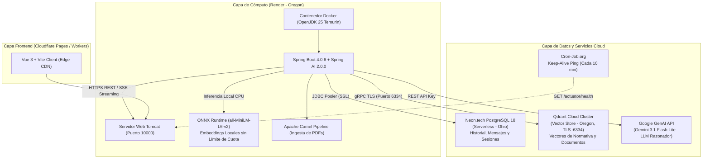

# INFORME TÉCNICO DE ARQUITECTURA Y DESPLIEGUE BACKEND EN LA NUBE
## Proyecto de Titulación: Simulador de Tránsito con Asistente RAG Inteligente (TransiAI)
**Servicio Desplegado:** `tesis-simulador-transito-backend`  
**Proveedor Cloud:** Render (PaaS - Platform as a Service)  
**URL de Producción:** [https://tesis-simulador-transito-backend.onrender.com](https://tesis-simulador-transito-backend.onrender.com)  
**Estado:** `Deploy Succeeded | Live` (En línea y operativo 24/7)

---

## 1. Resumen Ejecutivo de la Arquitectura Backend

El backend del sistema fue estructurado bajo una arquitectura de microservicios en la nube orientada a **RAG (Retrieval-Augmented Generation)** de alto rendimiento. Integra cómputo en contenedores Docker, bases de datos gestionadas independientes (vectorial y relacional), un motor neuronal embebido de embeddings mediante **ONNX Runtime** y el modelo de lenguaje de última generación **Google Gemini 3.1 Flash Lite** para generación conversacional en tiempo real mediante *Server-Sent Events (SSE)*.



---

## 2. Tecnologías y Plataformas Ocupadas

### A. Render (PaaS - Platform as a Service)
* **Función en el proyecto:** Plataforma de ejecución del contenedor del backend en la nube.
* **Región:** Oregon (`us-west`), elegida estratégicamente para estar en la misma zona que Qdrant Cloud y reducir la latencia de red a menos de 5 ms.
* **Runtime:** Docker multi-stage build (OpenJDK 25 Temurin).
* **Gestión de Recursos:** Ajuste fino de la máquina virtual de Java (`-Xms128m -Xmx220m -XX:+UseSerialGC`) para operar con estabilidad por debajo de los 250 MB de memoria RAM.
* **Endpoints de Monitoreo:** Expone verificación de salud en `/actuator/health` (liveness y readiness).

---

### B. Qdrant Cloud (Vector Database Cloud Cluster)
* **Función en el proyecto:** Base de datos vectorial para el motor RAG y búsqueda semántica de normativas de tránsito.
* **Protocolo:** gRPC sobre TLS en el puerto seguro `6334`.
* **Configuración del Motor RAG:**
  1. **TopK Optimizado (`topK = 6`):** Recupera los 6 fragmentos normativos más relevantes en cada consulta, asegurando que ante preguntas complejas de indemnizaciones o accidentes laborales se recuperen tanto el **Art. 369 del Código del Trabajo** (cálculo de 48 meses de remuneración) como las coberturas del **FONSAT/SPPAT**.
  2. **Metadatos e Índices de Palabras Clave:** Índices `keyword` para los campos `categoria` y `conversationId`, permitiendo filtrar documentos oficiales frente a archivos adjuntos temporales de los usuarios.

---

### C. ONNX Runtime (Embeddings Semánticos Locales)
* **Función:** Generación de vectores matemáticos densos (384 dimensiones) mediante el modelo `all-MiniLM-L6-v2`.
* **Ventajas en Producción:**
  * **Cero Cuotas y Sin Errores 429:** Elimina la dependencia de APIs externas con límites de peticiones diarias.
  * **Inferencia Inmediata:** La vectorización ocurre directamente sobre la CPU del contenedor en milisegundos.

---

### D. Google GenAI - Gemini 3.1 Flash Lite (LLM Generativo)
* **Función:** Modelo de lenguaje fundacional para razonamiento jurídico, redacción conversacional y análisis de infracciones.
* **Transmisión Fluida (SSE):** Emisión de tokens en paquetes Base64 a través del flujo `Flux<ServerSentEvent<String>>`.
* **Inyección de Fuentes Legales Estructuradas:** Al finalizar el flujo de tokens, el backend anexa el bloque `[LEGAL_SOURCES]` con el nombre oficial del cuerpo legal, título y extracto exacto obtenido de Qdrant, permitiendo al frontend generar las pastillas de citas de forma dinámica y sin quemar datos.

---

### E. Neon.tech (PostgreSQL Serverless)
* **Función:** Base de datos relacional transaccional para la persistencia permanente.
* **Ventajas:** A diferencia de las bases de datos temporales de Render (que caducan a los 30 días), Neon es permanente, cuenta con *Connection Pooling* nativo bajo SSL y no se suspende por inactividad.

---

### F. Apache Camel & Ingesta de Archivos
* **Función:** Pipeline de procesamiento de documentos PDF adjuntos por los usuarios.
* **Mejora Aplicada:** Incorporación de la anotación `@Handler` en `FileProcessor.java` para resolver ambigüedades en la invocación de métodos y garantizar la indexación fluida de documentos subidos hacia Qdrant.

---

### G. Cron-Job.org (Zero Cold-Start Keep-Alive)
* **Función:** Monitor automatizado que emite un ping `GET /actuator/health` cada 10 minutos (24/7).
* **Beneficio:** Evita que Render suspenda el contenedor por inactividad (después de 15 minutos), eliminando por completo la espera de 50 segundos de arranque en frío para el usuario final.

---

## 3. Matriz de Variables de Entorno en Producción (Render)

| Variable | Propósito | Configuración / Valor |
|---|---|---|
| `DATABASE_URL` | Cadena JDBC de conexión a Neon PostgreSQL | `jdbc:postgresql://ep-silent-shadow-...neon.tech/neondb?sslmode=require` |
| `DATABASE_USER` | Usuario administrador de la base de datos | `neondb_owner` |
| `DATABASE_PASSWORD` | Contraseña cifrada de acceso a Neon | *(Cifrada)* |
| `QDRANT_HOST` | Host directo del cluster de Qdrant Cloud | `45f892c8-...us-west-2-0.aws.cloud.qdrant.io` |
| `QDRANT_PORT` | Puerto de conexión gRPC seguro con TLS | `6334` |
| `QDRANT_API_KEY` | Token Bearer JWT para autenticación en Qdrant | *(Cifrado)* |
| `QDRANT_USE_TLS` | Habilitación de cifrado TLS obligatorio | `true` |
| `APP_KEY` | Clave de API de Google AI Studio para Gemini | *(Cifrada)* |
| `AI_MODEL` | Identificador del modelo fundacional | `gemini-3.1-flash-lite` |
| `FRONTEND_URL` | Origen autorizado para políticas de CORS | `https://tesis-simulador-transito-front.bapaca.workers.dev` |

---

## 4. Estado de Verificación en Vivo

1. **Salud del Sistema (`/actuator/health`):**
   ```json
   {"groups":["liveness","readiness"],"status":"UP"}
   ```
2. **Historial de Conversaciones (`/api/conversations`):**
   * Código de respuesta: **200 OK**.
   * Integración validada con Neon PostgreSQL y sesiones de usuario.
3. **Consulta Vectorial con RAG (`/api/chat`):**
   * Respuestas completas con respaldo del Código Orgánico Integral Penal (COIP), Ley Orgánica de Transporte Terrestre (LOTTTSV) y Código del Trabajo.
