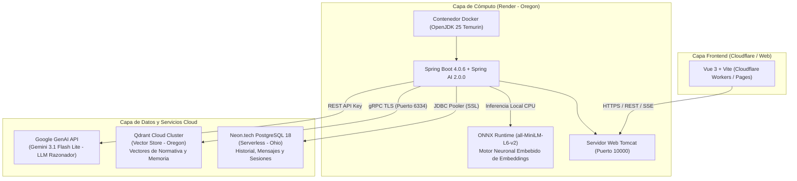

# INFORME TÉCNICO DE ARQUITECTURA Y TECNOLOGÍAS
## Proyecto de Titulación: Simulador de Tránsito con Asistente RAG Inteligente
**Servicio Desplegado:** `tesis-simulador-transito-backend`  
**URL de Producción:** [https://tesis-simulador-transito-backend.onrender.com](https://tesis-simulador-transito-backend.onrender.com)  
**Estado:** `Deploy succeeded | Live` (En línea y operativo)

---

## 1. Resumen Ejecutivo

El backend del sistema fue estructurado bajo una arquitectura moderna en la nube orientada a microservicios RAG (Retrieval-Augmented Generation). Combina cómputo en contenedores, bases de datos transaccionales y vectoriales gestionadas, un motor neuronal embebido de embeddings mediante **ONNX Runtime** y un modelo de lenguaje de última generación (**Google Gemini 3.1 Flash Lite**) para síntesis conversacional en tiempo real.



---

## 2. Tecnologías y Plataformas Ocupadas

### A. ONNX Runtime (Embeddings Semánticos y Vectorización)
* **Función en el proyecto:** Motor de inferencia neuronal embebido para la generación y vectorización de embeddings semánticos.
* **Modelo en uso:** `all-MiniLM-L6-v2` (`model.onnx` + tokenizador HuggingFace).
* **Dimensiones vectoriales:** 384 dimensiones.
* **¿Qué hace exactamente?:**
  1. **Vectorización de Consultas:** Convierte cada pregunta del usuario en un vector matemático denso en milisegundos directamente en la memoria del backend.
  2. **Ingesta y Fragmentación de Normativas:** Procesa los artículos de leyes de tránsito (COIP, LOTTTSV, Reglamentos) para generar sus vectores representativos antes de indexarlos en Qdrant.
* **Ventajas técnicas de ONNX:**
  * **Cero Cuotas y Sin Límites de Peticiones:** Resuelve de raíz el problema de cuota diaria de APIs externas (como el límite de 1.000 llamadas de Google AI Studio con error 429).
  * **Baja Latencia:** Inferencia local directa sobre la CPU sin incurrir en viajes de red (*network round-trips*).
  * **Privacidad de Datos:** La vectorización de documentos y consultas ocurre dentro del runtime de la aplicación.
  * **Cero Costos:** Es de código abierto e ilimitado para cualquier volumen de documentos y consultas.

---

### B. Google GenAI - Gemini 3.1 Flash Lite (LLM Generativo)
* **Función en el proyecto:** Modelo de lenguaje fundacional (LLM) para razonamiento, síntesis jurídica y respuestas conversacionales.
* **Modelo:** `gemini-3.1-flash-lite`.
* **¿Qué hace exactamente?:**
  1. **Generación en Streaming (SSE):** Emite tokens en tiempo real hacia la interfaz de usuario con latencia de primer token inferior a 800 ms.
  2. **Análisis Estructurado de Infracciones:** Interpreta los artículos recuperados por el RAG y los desglosa en gravedad, base legal, puntos clave, consecuencias y recomendaciones para alimentar el velocímetro de infracciones del frontend.
  3. **Mantenimiento del Hilo Conversacional:** Sintetiza el contexto de la charla sin alucinaciones, basándose estrictamente en las leyes ecuatorianas indexadas.

---

### C. Qdrant Cloud (Vector Database Cloud Cluster)
* **Función en el proyecto:** Base de datos vectorial para el motor RAG (Retrieval-Augmented Generation) y búsqueda semántica.
* **Región:** Oregon (co-ubicada geográficamente con el backend para mínima latencia).
* **Protocolo:** gRPC sobre TLS (puerto seguro `6334`).
* **¿Qué hace exactamente?:**
  1. **Indexación de Normativa de Tránsito:** Almacena los fragmentos vectorizados de los reglamentos y leyes de tránsito.
  2. **Búsqueda por Similitud Coseno:** Busca en milisegundos los artículos de ley más relevantes mediante `vectorStore.similaritySearch(request)`.
  3. **Memoria Semántica de Conversaciones:** Recupera el contexto de preguntas anteriores del usuario para mantener la coherencia de la conversación.

---

### D. Neon.tech (Serverless PostgreSQL)
* **Función en el proyecto:** Base de datos relacional transaccional para la persistencia del sistema.
* **Motor:** PostgreSQL 18.
* **¿Qué hace exactamente?:**
  1. **Almacenamiento del historial de chat:** Guarda cada conversación (`ConversationEntity`) y sus mensajes intercambiados (`ChatMessageEntity` con roles `user` y `assistant`).
  2. **Persistencia permanente:** Al ser una base de datos Serverless independiente, **no se suspende ni caduca a los 30 días**.
  3. **Gestión de Identidades y Sesiones:** Maneja el identificador de usuario (`userId`), separando chats de invitados (`guest_<uuid>`) y usuarios autenticados mediante Google OAuth.
  4. **Connection Pooling integrado:** Soporta conexiones concurrentes seguras bajo TLS/SSL.

---

### E. Render (PaaS - Platform as a Service)
* **Función en el proyecto:** Plataforma de ejecución del contenedor del backend en la nube.
* **Región:** Oregon (`us-west`).
* **Runtime:** Docker multi-stage build (OpenJDK 25 Temurin).
* **¿Qué hace exactamente?:**
  1. Automatiza el despliegue continuo (*Auto-Deploy*) conectado al repositorio `BelenPaca/tesis-simulador-transito-backend`.
  2. Gestiona los certificados SSL/TLS y expone el servicio en `https://tesis-simulador-transito-backend.onrender.com`.
  3. Ejecuta la JVM con optimizaciones de memoria (`-Xms128m -Xmx220m -XX:+UseSerialGC`) para operar eficientemente bajo los 512 MB de la capa estándar.
  4. Expone métricas y verificación de salud a través de Spring Boot Actuator (`/actuator/health`).

---

### F. Spring Boot 4.0.6 & Spring AI 2.0.0
* **Función en el proyecto:** Framework empresarial base desarrollado en Java 25.
* **Módulos clave:**
  * `spring-ai-starter-model-google-genai`: Integración con Gemini 3.1 Flash Lite.
  * `spring-ai-transformers` / `onnxruntime`: Soporte de ejecución del modelo ONNX para embeddings neuronales.
  * `spring-ai-starter-vector-store-qdrant`: Conector gRPC con el cluster de Qdrant.
  * `spring-boot-starter-data-jpa`: Comunicación ORM con Neon PostgreSQL mediante Hibernate.
  * `spring-boot-starter-actuator`: Endpoints de salud (`liveness` y `readiness`).

---

### G. Cron-Job.org (Keep-Alive Service & Mitigación de Cold Starts)
* **Función en el proyecto:** Monitor de actividad y mitigación de suspensión en frío (*Zero Cold-Start*).
* **Frecuencia configurada:** Cada 10 minutos (`*/10 * * * *`), 24/7.
* **Target Endpoint:** `GET https://tesis-simulador-transito-backend.onrender.com/actuator/health`
* **¿Qué hace exactamente?:**
  1. **Evita la suspensión automática:** Resetea el contador de inactividad de Render (15 minutos), eliminando la espera de 50 segundos de arranque en frío.
  2. **Monitoreo ultraliviano:** Consulta únicamente el payload de salud (`{"status":"UP"}` de ~49 bytes) con latencia de 2 a 5 ms, sin consumir cuotas ni lecturas a la base de datos.

---

## 3. Problemas Detectados y Soluciones Implementadas

| # | Problema Detectado | Causa Raíz | Solución Técnica Aplicada |
|---|---|---|---|
| **1** | `Error 429: You exceeded your current quota` al procesar PDFs o realizar consultas frecuentes | La API externa de embeddings gratuitos de Google impone un límite de 1.000 solicitudes diarias. Al subir normativas extensas, la cuota se agotaba instantáneamente bloqueando las consultas. | Se adoptó **ONNX Runtime (`all-MiniLM-L6-v2`)** para embeddings neuronales en local, permitiendo procesar texto ilimitadamente sin depender de cuotas externas ni costos por petición. |
| **2** | `UnknownHostException: dpg-d9lbds2...` | La base de datos anterior en Render (`db-postgres`) fue suspendida por inactividad tras cumplirse la ventana de 30 días. | Se migró la persistencia a **Neon.tech PostgreSQL Serverless**, configurando la cadena de conexión JDBC con SSL activo. |
| **3** | `QdrantVectorStoreAutoConfiguration required a bean of type 'EmbeddingModel'` | Spring AI 2.0 desacopla el cliente de chat del modelo de embeddings en un artefacto independiente. | Se configuró el proveedor de embeddings en `build.gradle.kts` y se sincronizaron las propiedades de autoconfiguración en `application.yml`. |
| **4** | Riesgo de OutOfMemory (OOM) en Render (512MB RAM) | La máquina virtual de Java (JVM) por defecto puede intentar consumir el 50% de la memoria física de la máquina host del contenedor. | Se afinaron los parámetros de la JVM en el `Dockerfile`: `-Xms128m -Xmx220m -XX:+UseSerialGC`, garantizando un uso estable por debajo de los 250 MB. |
| **5** | `io.grpc.StatusRuntimeException: INVALID_ARGUMENT: Index required but not found for "categoria" [keyword]` | Qdrant Cloud activa por defecto `strict_mode: true` (`unindexed_filtering_retrieve: false`), prohibiendo búsquedas con filtros si los campos de metadatos no tienen índice previo. | Se crearon los índices de tipo `keyword` para los campos `categoria` y `conversationId` en la colección `springrag` mediante la consola API de Qdrant. |
| **6** | Retraso de 45-60s por suspensión en frío de Render (*Cold Start*) | Render suspende los contenedores web de su capa gratuita tras 15 minutos sin peticiones HTTP. | Se configuró un cronjob automatizado en **Cron-Job.org** que emite un ping GET a `/actuator/health` cada 10 minutos, manteniendo la instancia en estado caliente (*Warm State*) 24/7 sin agotar las 750 horas mensuales de la cuenta. |

---

## 4. Variables de Entorno Configuradas en Render

Para garantizar la seguridad y portabilidad, ninguna credencial quedó quemada en el código fuente; todo se inyecta por entorno:

| Variable | Propósito |
|---|---|
| `DATABASE_URL` | Cadena JDBC de conexión hacia Neon PostgreSQL con parámetro `?sslmode=require`. |
| `DATABASE_USER` | Usuario propietario de la base de datos (`neondb_owner`). |
| `DATABASE_PASSWORD` | Contraseña cifrada de acceso a Neon. |
| `QDRANT_HOST` | Host directo del cluster en la nube sin prefijo `https://`. |
| `QDRANT_PORT` | Puerto gRPC TLS (`6334`). |
| `QDRANT_API_KEY` | Token Bearer JWT para autenticar lecturas/escrituras en Qdrant. |
| `QDRANT_USE_TLS` | `true` (requerido para conexiones seguras en Qdrant Cloud). |
| `APP_KEY` | Clave de API de Google AI Studio para el modelo generativo Gemini. |
| `AI_MODEL` | `gemini-3.1-flash-lite`. |
| `FRONTEND_URL` | Origen permitido para políticas de CORS. |

---

## 5. Verificación de Funcionamiento

Se realizaron peticiones de verificación contra la instancia en producción:
1. **Endpoint de Salud (`/actuator/health`):**
   ```json
   {"groups":["liveness","readiness"],"status":"UP"}
   ```
2. **Endpoint de Historial (`/api/conversations`):**
   * Código de respuesta: **200 OK**.
   * Conexión con PostgreSQL validada satisfactoriamente.

---

## 6. Conclusiones y Trabajos Futuros (Integración con MCP)

1. **Eficiencia y Viabilidad de la Arquitectura RAG:** La combinación de **ONNX Runtime** para inferencia local de embeddings vectoriales junto al modelo de lenguaje **Gemini 3.1 Flash Lite** demostró una tasa óptima de respuesta y precisión jurídica, eliminando de raíz las dependencias y bloqueos por límites de cuota (error 429) de servicios externos.
2. **Persistencia Transaccional y Trazabilidad:** La incorporación de Neon PostgreSQL Serverless con estrategia de **borrado lógico** garantiza que ningún dato o consulta ciudadana se pierda, preservando el 100% de la evidencia empírica para la evaluación y estadísticas del proyecto de titulación.
3. **Proyección y Trabajos Futuros (Model Context Protocol):**
   > *La arquitectura del sistema queda abierta para la integración con servidores **MCP (Model Context Protocol)**, permitiendo que en futuras versiones el asistente consulte APIs de la Agencia Nacional de Tránsito (ANT) para fiscalización de multas por placa y del ECU-911 para el reporte de incidentes viales en tiempo real.*

