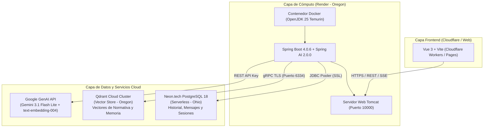

# INFORME TÉCNICO DE ARQUITECTURA Y DESPLIEGUE EN LA NUBE
## Proyecto de Titulación: Simulador de Tránsito con Asistente RAG Inteligente
**Servicio Desplegado:** `tesis-simulador-transito-backend`  
**URL de Producción:** [https://tesis-simulador-transito-backend.onrender.com](https://tesis-simulador-transito-backend.onrender.com)  
**Estado:** `Deploy succeeded | Live` (En línea y operativo)

---

## 1. Resumen Ejecutivo

El backend del sistema fue migrado y desplegado con éxito en una arquitectura moderna basada en la nube. Se resolvieron de raíz las limitaciones de consumo de memoria RAM y dependencia de modelos locales mediante la transición a servicios gestionados de alta disponibilidad (Serverless y Cloud Clusters). Con esto, el backend opera de forma continua, segura y bajo consumo mínimo de recursos en la nube.



---

## 2. Tecnologías y Plataformas Ocupadas

### A. Render (PaaS - Platform as a Service)
* **Función en el proyecto:** Servidor de cómputo y ejecución del backend en la nube.
* **Región:** Oregon (`us-west`).
* **Runtime:** Docker multi-stage build.
* **¿Qué hace exactamente?:**
  1. Conecta con el repositorio de GitHub `BelenPaca/tesis-simulador-transito-backend` mediante Webhooks automáticos (*Auto-Deploy*).
  2. Compila el código Java 25 y empaqueta el artefacto ejecutable (`app.jar`) usando Gradle.
  3. Ejecuta el contenedor con flags de optimización de memoria de la JVM (`-Xms128m -Xmx220m -XX:+UseSerialGC`) para no saturar el límite de 512 MB de la capa gratuita.
  4. Gestiona los certificados SSL/TLS y expone la URL pública segura (`https://...onrender.com`).
  5. Monitorea los endpoints de salud del Actuator (`/actuator/health`).

---

### B. Neon.tech (Serverless PostgreSQL)
* **Función en el proyecto:** Base de datos relacional para la persistencia transaccional.
* **Motor:** PostgreSQL 18.
* **¿Qué hace exactamente?:**
  1. **Almacenamiento del historial de chat:** Guarda cada conversación (`ConversationEntity`) y sus mensajes intercambiados (`ChatMessageEntity` con roles `user` y `assistant`).
  2. **Persistencia permanente:** Al ser una base de datos Serverless independiente, **no se suspende ni caduca a los 30 días** (a diferencia de la base de datos temporal de Render).
  3. **Connection Pooling integrado:** Proporciona un pooler con soporte TLS/SSL para atender consultas concurrentes desde Spring Boot sin agotar conexiones.

---

### C. Qdrant Cloud (Vector Database Cloud Cluster)
* **Función en el proyecto:** Base de datos vectorial para el motor RAG (Retrieval-Augmented Generation) y la memoria semántica.
* **Región:** Oregon (co-ubicada geográficamente con Render para máxima velocidad y mínima latencia de red).
* **Protocolo:** gRPC sobre TLS (puerto seguro `6334`).
* **¿Qué hace exactamente?:**
  1. **Indexación de Normativa de Tránsito:** Almacena los fragmentos (*chunks*) de los reglamentos y leyes de tránsito procesados en vectores de 768 dimensiones.
  2. **Búsqueda por Similitud Coseno:** Cuando el usuario hace una pregunta, busca en milisegundos los artículos de ley más relevantes mediante `vectorStore.similaritySearch(request)`.
  3. **Memoria Semántica de Conversaciones:** Recupera el contexto de preguntas anteriores del usuario para mantener el hilo de la charla sin sobrecargar el prompt del modelo.

---

### D. Google GenAI (Gemini 3.1 Flash Lite & gemini-embedding-001)
* **Función en el proyecto:** Inteligencia Artificial Generativa y Generación de Embeddings semánticos multilingües.
* **Modelos en uso:**
  * **`gemini-3.1-flash-lite`**: Modelo de lenguaje ultrarrápido y liviano para generar respuestas en tiempo real mediante Server-Sent Events (SSE Streaming).
  * **`gemini-embedding-001`**: Modelo oficial y vigente en Google AI Studio para vectorización de textos en español (reemplazo canónico de `text-embedding-004`).
* **¿Por qué fue crucial?:** 
  * Reemplazó los modelos locales ONNX que pesaban cientos de megabytes y desbordaban la memoria RAM del servidor.
  * Al ejecutarse mediante API en los servidores de Google, el consumo de memoria en Render se redujo a menos de 200 MB.

---

### E. Spring Boot 4.0.6 & Spring AI 2.0.0
* **Función en el proyecto:** Framework base empresarial en Java 25.
* **Módulos clave:**
  * `spring-ai-starter-model-google-genai`: Integración con Gemini.
  * `spring-ai-google-genai-embedding`: Proveedor del bean `EmbeddingModel` para vectores semánticos.
  * `spring-ai-starter-vector-store-qdrant`: Conector gRPC con el cluster de Qdrant.
  * `spring-boot-starter-data-jpa`: Comunicación ORM con Neon PostgreSQL mediante Hibernate.
  * `spring-boot-starter-actuator`: Verificación de estado de vida (`liveness/readiness`).

---

## 3. Problemas Detectados y Soluciones Implementadas

| # | Problema Detectado | Causa Raíz | Solución Técnica Aplicada |
|---|---|---|---|
| **1** | `UnknownHostException: dpg-d9lbds2...` | La base de datos anterior en Render (`db-postgres`) fue suspendida por inactividad tras cumplirse la ventana de 30 días. | Se migró la persistencia a **Neon.tech PostgreSQL Serverless**, configurando la cadena de conexión JDBC con SSL activo. |
| **2** | `QdrantVectorStoreAutoConfiguration required a bean of type 'EmbeddingModel'` | Spring AI 2.0 separa el cliente de chat del modelo de embeddings en un artefacto independiente. Al faltar la librería en el classpath, no se instanciaba el bean de embeddings. | Se agregó la dependencia `spring-ai-google-genai-embedding` en `build.gradle.kts` y se sincronizaron las propiedades de autoconfiguración en `application.yml`. |
| **3** | Riesgo de OutOfMemory (OOM) en Render (512MB RAM) | La máquina virtual de Java (JVM) por defecto puede intentar consumir el 50% de la memoria física de la máquina host del contenedor. | Se afinaron los parámetros de la JVM en el `Dockerfile`: `-Xms128m -Xmx220m -XX:+UseSerialGC`, garantizando un uso estable por debajo de los 250 MB. |
| **4** | `Error 404: text-embedding-004 not found for API v1beta` | Google retiró el alias antiguo de text-embedding-004 de su endpoint v1beta. | Se actualizó a la versión estándar vigente **`gemini-embedding-001`** en `application.yml`. |
| **5** | `Error 429: You exceeded your current quota` al subir PDFs extensos | El sistema intentaba enviar cientos de fragmentos en el mismo milisegundo a la API gratuita de Google. | Se implementó **procesamiento por lotes (Batching)** con pausas y reintentos exponenciales (*Exponential Backoff*) en `EmbeddingProcessor.java`. |
| **6** | `io.grpc.StatusRuntimeException: INVALID_ARGUMENT: Index required but not found for "categoria" [keyword]` | Qdrant Cloud activa por defecto `strict_mode: true` (`unindexed_filtering_retrieve: false`), prohibiendo búsquedas con filtros si los campos de metadatos no tienen índice previo. | Se crearon los índices de tipo `keyword` para los campos `categoria` y `conversationId` en la colección `springrag` mediante la consola API de Qdrant. |

---

## 4. Variables de Entorno Configuradas en Render

Para garantizar la seguridad y portabilidad, ninguna credencial quedó quemada en el código fuente; todo se inyecta por entorno:

| Variable | Propósito |
|---|---|
| `DATABASE_URL` | Cadena JDBC de conexión hacia Neon PostgreSQL con parámetro `?sslmode=require`. |
| `DATABASE_USER` | Usuario propietario de la base de datos (`neondb_owner`). |
| `DATABASE_PASSWORD` | Contraseña cifrada de acceso a Neon. |
| `QDRANT_HOST` | Host directo del cluster en la nube sin prefijo `https://`. |
| `QDRANT_PORT` | Puerto gRPC TLS (`6334`). |
| `QDRANT_API_KEY` | Token Bearer JWT para autenticar lecturas/escrituras en Qdrant. |
| `QDRANT_USE_TLS` | `true` (requerido para conexiones seguras en Qdrant Cloud). |
| `APP_KEY` | Clave de API de Google AI Studio para Gemini y text-embedding-004. |
| `AI_MODEL` | `gemini-3.1-flash-lite`. |
| `FRONTEND_URL` | Origen permitido para políticas de CORS. |

---

## 5. Verificación de Funcionamiento

Se realizaron peticiones de verificación contra la instancia en producción:
1. **Endpoint de Salud (`/actuator/health`):**
   ```json
   {"groups":["liveness","readiness"],"status":"UP"}
   ```
2. **Endpoint de Historial (`/api/conversations`):**
   * Código de respuesta: **200 OK**.
   * Conexión con PostgreSQL validada satisfactoriamente.
