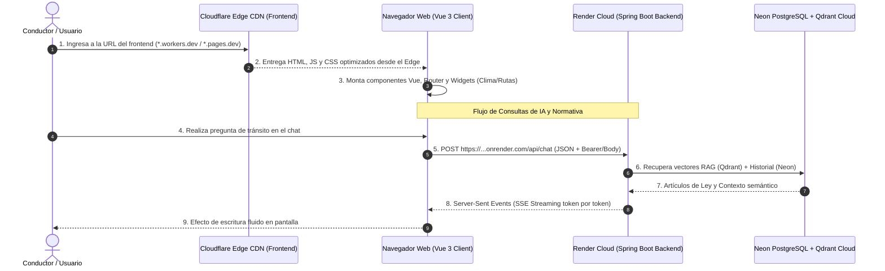

# INFORME TÉCNICO: DESPLIEGUE DEL FRONTEND EN CLOUDFLARE Y CONEXIÓN FULL-STACK
## Proyecto de Titulación: Simulador de Tránsito con Asistente RAG Inteligente
**Servicio Frontend:** `tesis-simulador-transito-front`  
**Proveedor Cloud:** Cloudflare Workers / Pages  
**Backend Vinculado:** `https://tesis-simulador-transito-backend.onrender.com`  
**Estado:** Integración y despliegue continuo (CI/CD)

---

## 1. Resumen Ejecutivo de la Arquitectura Full-Stack

El ecosistema de la aplicación opera desacoplado en dos capas de infraestructura en la nube:
1. **Frontend (Capa de Presentación):** Alojado en la red global *Edge* de **Cloudflare**, distribuyendo la interfaz de usuario en más de 300 centros de datos mundiales para carga ultrarrápida (baja latencia y alta disponibilidad).
2. **Backend (Capa de Cómputo y Lógica):** Alojado en **Render**, ejecutando el contenedor Docker con Spring Boot 4, Google GenAI, Qdrant Cloud y Neon PostgreSQL.

El siguiente diagrama ilustra el flujo de comunicación e integración entre ambas plataformas:



---

## 2. Tecnologías y Herramientas Ocupadas en el Frontend

### A. Cloudflare (Cloudflare Workers / Cloudflare Pages)
* **Función:** Red de distribución de contenido (*Content Delivery Network* - CDN) y servidor *Edge* para la interfaz gráfica.
* **¿Qué hace exactamente?:**
  1. **Alojamiento y Despliegue Global:** En lugar de requerir un servidor dedicado con Linux/Apache, Cloudflare distribuye los archivos compilados (`dist/`) en centros de datos ubicados en todo el mundo (incluyendo puntos de presencia en Sudamérica/Ecuador).
  2. **Manejo de Rutas SPA (*Single Page Application*):** A través de `wrangler.json`, configura la directiva:
     ```json
     "assets": {
       "directory": "./dist",
       "not_found_handling": "single-page-application"
     }
     ```
     Esto asegura que al recargar la página directamente en la ruta `/chat` (o en la raíz `/`), Cloudflare no devuelva error 404 (File Not Found), sino que redirija el tráfico al archivo principal `index.html` para que Vue Router tome el control.
  3. **Seguridad y Cifrado HTTPS Automático:** Emite certificados SSL/TLS con cifrado HTTP/2 y HTTP/3 nativo, protegiendo las sesiones contra ataques DDoS.
  4. **Dominio Público:** Asigna un subdominio público accesible mundialmente (`*.workers.dev` o `*.pages.dev`).
  5. **Directiva de Compatibilidad (`compatibility_date: 2024-09-23`):** Define la versión base estable del runtime de Workers en la que se congelan las características del motor JS, garantizando compatibilidad total y evitando rechazos por fechas futuras en la API de Cloudflare.

---

### B. Vue 3 (Composition API) & Vite 8
* **Función:** Núcleo de desarrollo de la interfaz de usuario moderna.
* **Componentes Principales:**
  * **LandingView.vue:** Pantalla principal de bienvenida con acceso rápido y diseño interactivo.
  * **ChatView.vue:** Consola interactiva del asistente inteligente TransiAI, dashboard de infracciones, gestión de historial de actividad y widgets en tiempo real.
  * **Vue Router 4:** Navegación fluida del lado del cliente sin parpadeos de recarga entre la bienvenida y la sala de chat.
* **Vite 8:** Herramienta de compilación ultrarrápida (*bundler*) que empaqueta y minimiza los archivos JavaScript y estilos CSS en la carpeta optimizada `dist/`.

---

### C. APIs Auxiliares Integradas en el Frontend
* **Open-Meteo & BigDataCloud:** Detección de geolocalización y estado del tiempo en vivo con iconos dinámicos (día/noche, lluvia, niebla) para alertas viales preventivas.
* **TomTom Maps & Routing SDK:** Estimación de tráfico, tiempos de viaje y rutas alternas visualizadas directamente en el panel lateral del chat.

---

## 3. ¿Cómo se Conectan el Frontend y el Backend? (Paso a Paso)

Para que el frontend en Cloudflare pueda dialogar con el backend en Render, se implementan tres mecanismos clave:

### 1. Variables de Entorno en el Frontend (`VITE_API_BASE_URL`)
En desarrollo local, el frontend apunta a `http://localhost:5173`. En producción (Cloudflare), el código cliente detecta dinámicamente si existe una variable de entorno:
```javascript
// src/config.js o dentro de los servicios
export const API_BASE_URL = import.meta.env.VITE_API_BASE_URL || 'https://tesis-simulador-transito-backend.onrender.com';
```

Al compilar o desplegar en Cloudflare, todas las llamadas se redirigen a la URL pública de Render:
* `GET ${API_BASE_URL}/api/conversations` (Listar historial)
* `POST ${API_BASE_URL}/api/chat` (Consultar al asistente con Streaming)
* `DELETE ${API_BASE_URL}/api/conversations/{id}` (Eliminar consulta individual)
* `DELETE ${API_BASE_URL}/api/conversations` (Borrar toda la actividad)
* `POST ${API_BASE_URL}/api/documents/upload` (Ingesta de documentos RAG)

---

### 2. Configuración de CORS en el Backend (Render)
Los navegadores bloquean por seguridad cualquier petición JavaScript que vaya desde un dominio (ej. `*.workers.dev`) hacia otro dominio diferente (`*.onrender.com`). A esto se le conoce como **CORS (Cross-Origin Resource Sharing)**.

En el backend de Spring Boot, esto se encuentra solventado mediante el componente `CorsConfig.java`:
```java
@Configuration
public class CorsConfig {
    @Bean
    public WebMvcConfigurer corsConfigurer() {
        return new WebMvcConfigurer() {
            @Override
            public void addCorsMappings(CorsRegistry registry) {
                registry.addMapping("/**")
                        .allowedOrigins("*")
                        .allowedMethods("GET", "POST", "PUT", "DELETE", "OPTIONS")
                        .allowedHeaders("*");
            }
        };
    }
}
```
* **Qué hace:** Le responde al navegador con las cabeceras `Access-Control-Allow-Origin: *`, autorizando al frontend de Cloudflare a leer las respuestas del servidor sin bloqueos de seguridad.

---

### 3. Comunicación por Streaming (Server-Sent Events - SSE)
La consulta al asistente no es una petición tradicional que espera 10 segundos a que el texto esté completo. Utiliza **Server-Sent Events**:
1. El frontend abre una conexión `POST` con cabecera `Accept: text/event-stream`.
2. El backend en Render genera los tokens con Gemini y los envía de inmediato en paquetes Base64 a través del flujo `Flux<ServerSentEvent<String>>`.
3. El frontend decodifica cada trozo de texto en tiempo real (`TextDecoder`) y lo añade reactivamente al mensaje visible en la pantalla.

---

## 4. Matriz Comparativa de Roles en la Arquitectura

| Dimensión | Frontend (Cloudflare) | Backend (Render) |
|---|---|---|
| **Tecnología** | Vue 3 + Vite + JavaScript | Spring Boot 4 + Java 25 (Docker) |
| **Tipo de Servicio** | Edge CDN / Static Assets Hosting | Container PaaS (API Server) |
| **Responsabilidad** | Interfaz visual, reactividad, mapa TomTom y clima | Lógica de negocio, RAG, IA y consultas SQL |
| **Consumo de Memoria** | Ejecutado en el cliente (0 MB de servidor) | ~200 MB en Render (JVM optimizada) |
| **Seguridad de Claves** | Claves públicas de mapas y clima | Claves privadas (Gemini, Neon, Qdrant) protegidas |

---

## 5. Resumen de Pasos para la Puesta en Producción

1. **Construcción del Frontend:**  
   Se ejecuta `npm run build` en el repositorio frontend para generar el paquete estático en `dist/`.
2. **Despliegue a Cloudflare:**  
   Mediante GitHub Actions o el CLI `wrangler deploy`, Cloudflare publica la carpeta `dist/` con las rutas SPA controladas.
3. **Vinculación de URLs:**  
   * En Cloudflare: Se configura `VITE_API_BASE_URL = https://tesis-simulador-transito-backend.onrender.com`.
   * En Render: Se configura `FRONTEND_URL = https://[tu-subdominio].workers.dev` para restringir el origen seguro de peticiones si se desea.
