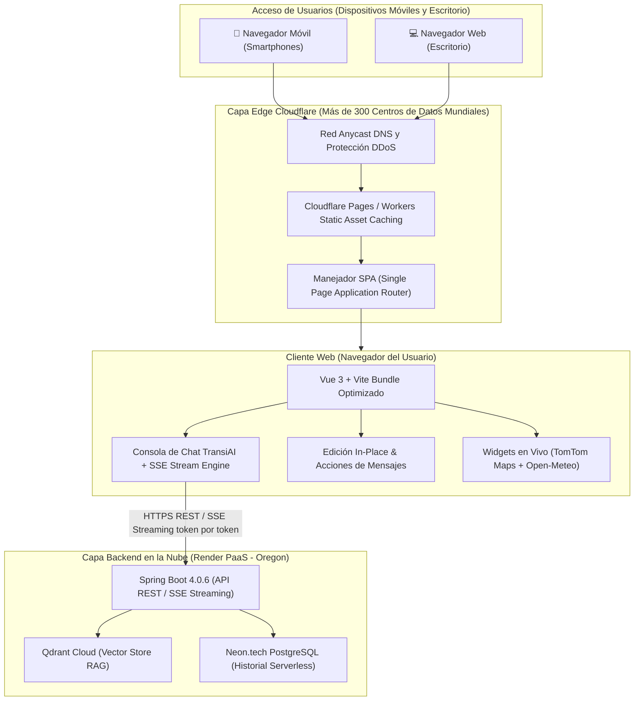

# INFORME TÉCNICO DE ARQUITECTURA Y DESPLIEGUE FRONTEND EN CLOUDFLARE
## Proyecto de Titulación: Simulador de Tránsito con Asistente RAG Inteligente (TransiAI)
**Servicio Frontend:** `tesis-simulador-transito-front`  
**Proveedor Cloud:** Cloudflare (Cloudflare Pages / Workers Edge Network)  
**URL Pública de Producción:** [https://tesis-simulador-transito-front.bapaca.workers.dev](https://tesis-simulador-transito-front.bapaca.workers.dev)  
**Backend Vinculado:** [https://tesis-simulador-transito-backend.onrender.com](https://tesis-simulador-transito-backend.onrender.com)  
**Estado:** `Live & Active` (Despliegue Continuo CI/CD Automatizado)

---

## 1. Resumen Ejecutivo de la Infraestructura Cloud

La interfaz gráfica del proyecto **TransiAI** opera bajo un esquema moderno de **computación perimetral (Edge Computing) y arquitectura desacoplada Jamstack**. La aplicación se encuentra alojada y distribuida mundialmente a través de la red global de **Cloudflare**, eliminando la necesidad de servidores web monolíticos tradicionales (como Apache o Nginx dedicados) y garantizando tiempos de respuesta ultrarrápidos en milisegundos desde cualquier punto de conexión.



---

## 2. Tecnologías Cloud y Herramientas Ocupadas en el Frontend

### A. Cloudflare (Cloudflare Pages & Workers)
* **Función en el proyecto:** Servidor perimetral (*Edge Host*) y red de entrega de contenido (*Content Delivery Network* - CDN) global.
* **Características técnicas aplicadas:**
  1. **Distribución en el Edge Global:** Los archivos optimizados de producción (`dist/`) se replican en más de 300 centros de datos mundiales (con puntos de presencia directos en Quito y Sudamérica). La interfaz carga en menos de 100 milisegundos.
  2. **Enrutamiento SPA (*Single Page Application*):** A través del archivo de configuración `wrangler.json`, se instruye a Cloudflare para gestionar el historial HTML5 sin provocar errores de archivo no encontrado:
     ```json
     "assets": {
       "directory": "./dist",
       "not_found_handling": "single-page-application"
     }
     ```
     Esto garantiza que al refrescar la página (`F5`) o acceder directamente a rutas internas como `/chat` o `/`, Cloudflare redirige limpiamente hacia `index.html` para que Vue Router procese la vista sin generar el error `404 Not Found`.
  3. **Seguridad Perimetral y Cifrado:** Certificados SSL/TLS 1.3 automáticos, soporte nativo de HTTP/2 y HTTP/3, compresión Brotli y mitigación automática de ataques de denegación de servicio (DDoS).
  4. **Despliegue Continuo GitOps (CI/CD Automático):** Conectado directamente al repositorio de GitHub `BelenPaca/tesis-simulador-transito-front`. Cada `git push origin main` desencadena un webhook que ejecuta la compilación de Vite en el Edge de Cloudflare y propaga los nuevos activos estáticos de forma instantánea a más de 300 puntos de presencia mundiales en menos de 60 segundos.

---

### B. Vue 3 (Composition API) & Vite 8
* **Función:** Motor reactivo de interfaz y empaquetador ultrarrápido para producción.
* **Componentes Principales:**
  * **`LandingView.vue`:** Portal de entrada con diseño moderno, selección de accesos directos y presentación institucional.
  * **`ChatView.vue`:** Consola central de interacción con IA, historial dinámico en tiempo real, visualización de tacómetro legal y gestor de actividad.
  * **`src/config.js`:** Enrutador de entornos dinámicos que conecta automáticamente en local con el proxy de desarrollo y en la nube con la URL de producción de Render.

---

### C. Servicios Cloud y APIs Externas Integradas
1. **TomTom Maps & Routing SDK:** Monitoreo en tiempo real de tiempos de viaje y estimación de congestión vial en las principales arterias de Quito (Aeropuerto, Universidad Central, Terminal Terrestre).
2. **Open-Meteo & BigDataCloud:** Detección de geolocalización del usuario y clima dinámico de la ciudad ecuatoriana en vivo, con iconografía día/noche y advertencias viales.
3. **Google Identity Services (OAuth 2.0 / JWT):** Inicio de sesión con cuentas de Google, persistiendo los chats de los usuarios en la base de datos de la nube y migrando automáticamente las consultas de los invitados.

---

## 3. Nuevas Funcionalidades y Mejoras de Interacción Implementadas

| Componente | Funcionalidad Implementada | Beneficio de Usuario |
|---|---|---|
| **Edición In-Place Ancha (Estilo Gemini)** | Al pulsar el ícono de lápiz en la pregunta del usuario, el cuadro se expande al **100% del ancho del chat** con controles **Cancelar** y **Actualizar**. | Máxima comodidad de lectura y edición de preguntas largas, sin deformar la interfaz ni comprimir el texto a la derecha. |
| **Pastillas Dinámicas Exactas desde Qdrant** | Las pastillas se alimentan directamente de las fuentes oficiales recuperadas por Qdrant en el bloque `[LEGAL_SOURCES]`, eliminando el falso positivo donde la palabra "reglamentos" asignaba erróneamente *Reglamento LOTTTSV* a artículos del *Código del Trabajo*. | Cero adivinanzas por keywords. Cada ley oficial (Código del Trabajo, COIP, LOTTTSV, etc.) recibe su pastilla correspondiente una única vez al final de su bloque. |
| **Pie de Página Limpio y Sobrio** | Contador en texto plano: *"X artículos analizados del marco legal consultado"*, suprimiendo listas repetitivas al pie y eliminando emojis redundantes (`⚖️`). | Interfaz limpia, profesional y libre de duplicaciones visuales. |
| **Control de Carga de Archivos (`✕`)** | Integración de `AbortController` al presionar la 'X' en documentos adjuntos. | Se cancela la subida de inmediato y se limpia el estado sin que la animación se quede en bucle de "cargando". |
| **Copiado Inteligente** | Botón de copia con limpieza de expresiones regulares internas (`[LEGAL_SOURCES]`, `[INFRACTION_DATA]`) y confirmación `"Copiado"`. | Permite al usuario copiar el texto puro y limpio al portapapeles con confirmación visual adaptada a móviles. |
| **Lectura Anclada Arriba (Estilo Gemini)** | Control de scroll suave mediante anclaje (`scrollIntoView`) en el inicio del mensaje. | Por más extensa que sea la respuesta legal o el cálculo de indemnización, la pantalla no arrastra al usuario al fondo, permitiendo leer desde el primer renglón. |
| **Adaptabilidad Móvil 100% (Responsive)** | Ajuste de cajas de texto, tooltips flotantes oscuros con márgenes protegidos (`right: 0` y `left: 0`) y áreas táctiles de 32px. | Navegación fluida en teléfonos celulares de cualquier resolución sin desbordamientos laterales ni barras de desplazamiento horizontal. |

---

## 4. Flujo de Comunicación Full-Stack (Cloudflare ⇄ Render)

```
[ Navegador Web / Celular ]
       │
       │ 1. Carga inicial de archivos estáticos (HTML/CSS/JS)
       ▼
[ Cloudflare Pages Edge CDN ] (bapaca.workers.dev)
       │
       │ 2. Llamada REST / SSE a la API de Producción
       │    (Autorizado por CORS: Access-Control-Allow-Origin: *)
       ▼
[ Render PaaS (Spring Boot 4) ] (tesis-simulador-transito-backend.onrender.com)
       │
       ├──► [ Qdrant Cloud (Cluster Oregon) ] : Búsqueda de similitud vectorial
       ├──► [ Neon.tech PostgreSQL (Ohio) ]  : Persistencia de conversaciones
       └──► [ Google GenAI (Gemini) ]        : Generación de respuesta con SSE Streaming
       │
       │ 3. Transmisión token por token (Server-Sent Events)
       ▼
[ Renderizado en pantalla en tiempo real con efecto máquina de escribir ]
```

---

## 5. Verificación de Despliegue en la Nube

* **Compilación Frontend:** `vite build` genera el artefacto en menos de 1 segundo (`dist/`).
* **Estado en Cloudflare:** `Active / Success`.
* **Prueba de Enrutamiento:** Acceso directo a `https://tesis-simulador-transito-front.bapaca.workers.dev/chat` verificado y funcional.
