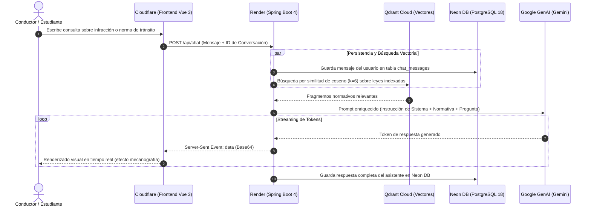

# INFORME TÉCNICO: ARQUITECTURA DE INTEGRACIÓN Y UNIÓN FULL-STACK (CLOUDFLARE - RENDER)
## Proyecto de Titulación: Simulador de Tránsito con Asistente RAG Inteligente
**Capa Cliente (Frontend):** Cloudflare Workers / Pages (`tesis-simulador-transito-front`)  
**Capa Servidor (Backend):** Render PaaS (`https://tesis-simulador-transito-backend.onrender.com`)  
**Mecanismo de Conexión:** REST API + Server-Sent Events (SSE) con Detección Dinámica de Entorno

---

## 1. Objetivo del Informe

Documentar técnicamente cómo se resolvió la integración y comunicación entre la interfaz de usuario alojada en la infraestructura global de **Cloudflare** y el servidor de procesamiento alojado en **Render**, manteniendo al mismo tiempo la compatibilidad con el entorno de desarrollo local sin alterar el flujo de trabajo del desarrollador.

---

## 2. El Desafío Técnico de la Separación de Entornos

En una arquitectura desacoplada (*Decoupled / Headless Architecture*):
* El **Frontend** y el **Backend** están alojados en dos dominios públicos completamente distintos:
  * Dominio Frontend: `https://tesis-simulador-transito-front.bapaca.workers.dev` (Cloudflare)
  * Dominio Backend: `https://tesis-simulador-transito-backend.onrender.com` (Render)
* **El problema de las rutas relativas:**  
  Originalmente, el cliente realizaba peticiones directas como `fetch('/api/chat')`.  
  * En entorno local, Vite resolvía esto con su proxy interno hacia `localhost:5173`.
  * En la nube (Cloudflare), al no existir un servidor Spring Boot detrás del mismo dominio, el navegador solicitaba el recurso a Cloudflare, resultando en un error **HTTP 404 Not Found**.

---

## 3. Solución Implementada: Conector Inteligente de Entorno

Se creó un módulo de resolución dinámica denominado `src/config.js`, el cual inspecciona las variables de compilación del empaquetador Vite:

```javascript
// src/config.js
export const API_BASE_URL = import.meta.env.VITE_API_URL || 
  (import.meta.env.DEV ? '' : 'https://tesis-simulador-transito-backend.onrender.com');
```

### Principio de Funcionamiento:
1. **Modo Desarrollo (`import.meta.env.DEV === true`):**
   * El valor de `API_BASE_URL` se evalúa como una cadena vacía `''`.
   * Las peticiones se resuelven como `/api/...`, permitiendo que el proxy local de desarrollo funcione sin ninguna alteración ni necesidad de conexión a internet externa.
2. **Modo Producción (`import.meta.env.DEV === false`):**
   * El valor de `API_BASE_URL` se resuelve automáticamente a `https://tesis-simulador-transito-backend.onrender.com`.
   * Todas las peticiones del navegador se dirigen con URL absoluta directamente a la infraestructura en Render.

---

## 4. Matriz de Endpoints Conectados en `ChatView.vue`

Todas las operaciones de la interfaz fueron actualizadas para consumir el conector centralizado:

| Funcionalidad | Endpoint Destino | Método | Tipo de Comunicación | Propósito en la Aplicación |
|---|---|:---:|:---:|---|
| **Carga de Historial** | `${API_BASE_URL}/api/conversations` | `GET` | JSON | Recupera el listado de conversaciones persistidas en Neon PostgreSQL. |
| **Carga de Mensajes** | `${API_BASE_URL}/api/conversations/{id}/messages` | `GET` | JSON | Carga el hilo cronológico de preguntas y respuestas de una conversación. |
| **Consulta Inteligente (IA)** | `${API_BASE_URL}/api/chat` | `POST` | **SSE Stream** | Transmite la respuesta del modelo Gemini en tiempo real mediante tokens codificados en Base64. |
| **Eliminar Conversación** | `${API_BASE_URL}/api/conversations/{id}` | `DELETE` | REST | Elimina una conversación y sus mensajes asociados en la base de datos. |
| **Borrado Completo** | `${API_BASE_URL}/api/conversations` | `DELETE` | REST | Limpieza masiva de todas las consultas del historial. |
| **Indexación Documental** | `${API_BASE_URL}/api/documents/upload` | `POST` | `multipart/form-data` | Sube documentos PDF/texto para fragmentación y almacenamiento vectorial en Qdrant Cloud. |

---

## 5. Arquitectura de Seguridad y CORS (Cross-Origin Resource Sharing)

Dado que las peticiones se realizan entre dos dominios de origen cruzado, los navegadores aplican la directiva de seguridad *Same-Origin Policy*. Para autorizar las transacciones, el backend en Render responde con las cabeceras requeridas a través de la clase `CorsConfig.java`:

```java
@Configuration
public class CorsConfig {
    @Bean
    public WebMvcConfigurer corsConfigurer() {
        return new WebMvcConfigurer() {
            @Override
            public void addCorsMappings(CorsRegistry registry) {
                registry.addMapping("/**")
                        .allowedOrigins("*")
                        .allowedMethods("GET", "POST", "PUT", "DELETE", "OPTIONS")
                        .allowedHeaders("*");
            }
        };
    }
}
```

* **Preflight Requests (`OPTIONS`):** Cuando el frontend envía un `POST` con cabecera `Content-Type: application/json`, el navegador envía primero una consulta de verificación preliminar (`OPTIONS`). El backend responde inmediatamente con código **200 OK**, autorizando el envío del cuerpo de la petición.

---

## 6. Diagrama de Secuencia del Flujo Integrado



---

## 7. Conclusión del Proceso de Integración

La arquitectura adoptada garantiza:
1. **Desacoplamiento Absoluto:** El frontend puede desplegarse, actualizarse o rehacerse sin afectar al backend, y viceversa.
2. **Cero Impacto Local:** El entorno de pruebas en la computadora de desarrollo no se vio afectado; sigue operando de forma transparente.
3. **Escalabilidad y Reducción de Costos:** El frontend se sirve desde la red Edge de Cloudflare (sin costo de cómputo de servidor), mientras que el backend y sus bases de datos operan en capas gratuitas y serverless optimizadas en consumo de memoria.
